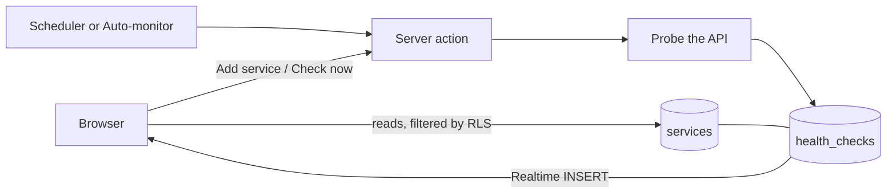

<div align="center">

# API Health Engine

**Real-time uptime, latency and incident monitoring for the APIs you run.**
Private by design: every account sees only the endpoints it added.


</div>

<!-- Add screenshots here once deployed, e.g. docs/landing.png and docs/dashboard.png -->

---

## Table of contents

1. [Features](#features)
2. [How it works](#how-it-works)
3. [Tech stack](#tech-stack)
4. [Getting started](#getting-started)
5. [Environment variables](#environment-variables)
6. [Database setup](#database-setup)
7. [Security model](#security-model)
8. [Project structure](#project-structure)
9. [Deployment](#deployment)
10. [Performance notes](#performance-notes)
11. [Troubleshooting](#troubleshooting)
12. [Roadmap](#roadmap)

---

## Features

**Public site**
- Light glassmorphism landing page with an animated wave, a bento feature grid and a short how-it-works section. It shows no live or customer data.

**Accounts**
- Email and password sign-up and login (any address, including Gmail).
- Forgot-password and reset-password by email.
- Login is mandatory for the app. Signing out returns you to the landing page.

**Dashboard**
- Live status cards that glow emerald, amber or rose as each check lands (Supabase Realtime).
- Stats for the last 24 hours: uptime ring, healthy / degraded / down counts, average latency.
- Latency chart per service, status mix donut, and a trend line inside every card.
- Search by name or URL, filter by status, paging.
- **Add service** form and a **Check now** button on every card.
- **Auto-monitor** probes every active service once a minute while the dashboard is open.

**Service detail page**
- History for 24 hours, 7 days or 30 days.
- 30-day uptime bar, latency chart with the 500 ms threshold, and latency distribution.
- Paged check log with a status filter.
- State-change timeline (for example `healthy → down`) and the latest response headers.
- Pause, resume and delete.

## How it works



**Health rules**

| Result | Condition |
|---|---|
| Healthy | Status code matches the expected one and the response took under 500 ms |
| Degraded | Status code matches but the response took 500 ms or more |
| Down | Status code mismatch, a network error, or no answer within 5 seconds |

## Tech stack

| Area | Tools |
|---|---|
| Framework | Next.js 16 (App Router, Turbopack), React 19, TypeScript |
| Data and auth | Supabase: Postgres, Row Level Security, Auth, Realtime |
| UI | Tailwind CSS v4, Framer Motion, Recharts, Lucide icons |

## Getting started

**Prerequisites:** Node.js 20 or newer and a Supabase project.

```bash
# 1. Install dependencies
npm install
npm i framer-motion recharts lucide-react @supabase/ssr @supabase/supabase-js
npm i -D tailwindcss@4 @tailwindcss/postcss postcss

# 2. Create postcss.config.mjs in the project root (see below)

# 3. Add your environment variables (see next section)

# 4. Run the SQL files in the sql/ folder (see Database setup)

# 5. Start the app
npm run dev
```

`postcss.config.mjs`:

```js
const config = { plugins: { "@tailwindcss/postcss": {} } };
export default config;
```

Open <http://localhost:3000>.

| Script | What it does |
|---|---|
| `npm run dev` | Development server (compiles each page on first visit, so it feels slower) |
| `npm run build` | Production build |
| `npm run start` | Serve the production build. Use this to judge real speed |

## Environment variables

Create `.env.local` in the project root:

```bash
NEXT_PUBLIC_SUPABASE_URL=https://<project-ref>.supabase.co
NEXT_PUBLIC_SUPABASE_ANON_KEY=<anon public key>
SUPABASE_SERVICE_ROLE_KEY=<service role key>   # server only
```

> **Never** put the service role key in a `NEXT_PUBLIC_` variable or in client code. It bypasses all security rules.
> Make sure `DEV_SKIP_AUTH` is **not** set. The app no longer reads it, and login is always required.

Find the values in Supabase under **Project Settings → API**.

## Database setup

Run the files in `sql/` in numeric order from the Supabase **SQL Editor**.

The final file, `06_private_per_user.sql`, is what makes the app private per user. It:

1. adds an owner column (`services.user_id`) that is filled in automatically for new rows,
2. turns on Row Level Security for `services` and `health_checks`,
3. removes any older, more permissive policies,
4. lets each signed-in user read and change only their own services and the checks that belong to them,
5. removes access for signed-out visitors, and
6. makes the `incidents` view and the dashboard functions run with the caller's rights.

**Before running it**, existing services have no owner. Find your user id in **Authentication → Users**, then use the commented `UPDATE` in step 2 of the file to assign them to yourself. Rows without an owner are invisible to everyone.

**Realtime:** `health_checks` and `services` must be part of the `supabase_realtime` publication so cards update live.

**Email settings** (Authentication in Supabase):
- *Providers → Email:* keep it on. Turn **Confirm email** off while testing for instant sign-ups, and back on for real users (the built-in mailer only sends a few emails per hour on the free plan).
- *URL Configuration:* set the Site URL to `http://localhost:3000` and add `http://localhost:3000/auth/callback` as a redirect URL. Add your production domain too after deploying.

## Security model

| Layer | What it does |
|---|---|
| `proxy.ts` | Redirects signed-out visitors from `/dashboard` and `/services/*` to `/login`, and signed-in users away from `/login` and `/register` |
| `requireUser()` | Every protected page verifies the session again on the server, because layouts and pages render independently |
| Row Level Security | The real boundary. Even a forged request cannot read another user's rows |
| Server-only secrets | The service role key is used only in server code (the health probe) |

Notes:
- Sessions are verified with `getClaims()`: locally against your project's signing keys when possible, otherwise through the Supabase auth server. A cookie alone is never trusted.
- Any server action or API route that uses the service role key **bypasses RLS**. Each one that takes a service id must first confirm the service belongs to the signed-in user.
- The scheduled-check route must require a secret so it cannot be triggered by strangers.

## Project structure

```
app/
├─ page.tsx                   Landing page (static, no data)
├─ login/ register/           Email + password auth
├─ forgot-password/ reset-password/
├─ auth/callback/             Handles confirm-email and reset-password links
├─ auth/signout/              POST: signs out, redirects to the landing page
├─ dashboard/                 Stats, charts, cards, search, filter, paging
└─ services/[id]/             History, check log, charts, state changes, headers
components/                   UI: StatusCard, Charts, ChartsLazy, StatsBento, AddServiceModal, ...
lib/frontend/
├─ auth.ts                    requireUser(): cached, verified session lookup
├─ analytics.ts               Pure functions: stats, series, sparklines, histograms
├─ service.ts                 Detects your services column names; search filter
├─ status.ts                  Row normalisers and formatting helpers
├─ actions.ts                 The only file that calls the server actions
└─ types.ts
proxy.ts                      Route protection
sql/                          Database scripts
```

The existing backend lives alongside this: `lib/supabase/*`, `lib/health/*`, `app/api/health-check` and `app/actions/services.ts`.

## Deployment

1. Push the repository to GitHub and import it into [Vercel](https://vercel.com).
2. Add the three environment variables from above. Do **not** add `DEV_SKIP_AUTH`.
3. In Supabase, add your production URL to **Authentication → URL Configuration** (Site URL and `/auth/callback`).
4. Deploy.

**Continuous history (important).** Checks run only when someone clicks *Check now* or has the dashboard open with Auto-monitor on. To keep recording while nobody is looking, schedule a call to `/api/health-check` every minute or two (Vercel Cron or Supabase `pg_cron`) and protect that route with a secret.

## Performance notes

- Sign-in is verified once per request and shared by the layout and page.
- Charts load after the page paints; live updates are applied in batches; cards re-render only when their own data changes.
- The dashboard sends the browser only the last 24 hours of checks, trimmed to the fields it needs.
- Judge speed with `npm run build && npm run start`. The dev server is always slower.

## Troubleshooting

| Symptom | Fix |
|---|---|
| Page looks like an unstyled document | Add `postcss.config.mjs` (above), run `npm i -D @tailwindcss/postcss postcss`, delete `.next`, restart |
| Strange runtime error right after replacing files | Stop the dev server, delete `.next`, start again |
| Cards show no URL, or search finds nothing | Run the latest code: column names are detected from your data in `lib/frontend/service.ts` |
| "url is invalid" or "formData.get is not a function" when adding a service | The add action reads `FormData`. See `lib/frontend/actions.ts`, the only file to adjust |
| Dashboard empty after running `06` | Your existing services have no owner yet. Assign them with the `UPDATE` in the SQL file |
| No confirmation email arrives | Supabase's built-in mailer is rate limited. Turn off **Confirm email** while testing |
| Cards never update live | Add `health_checks` and `services` to the `supabase_realtime` publication |
| History has gaps | Nothing is checking while the dashboard is closed. Add a scheduled call to `/api/health-check` |

## Roadmap

- Email or webhook alerts when a service goes down
- Edit service form
- Per-service check interval
- Public status pages
- Social sign-in (Google, GitHub)

---

<div align="center">

Built with Next.js, Supabase and Tailwind CSS.

</div>
